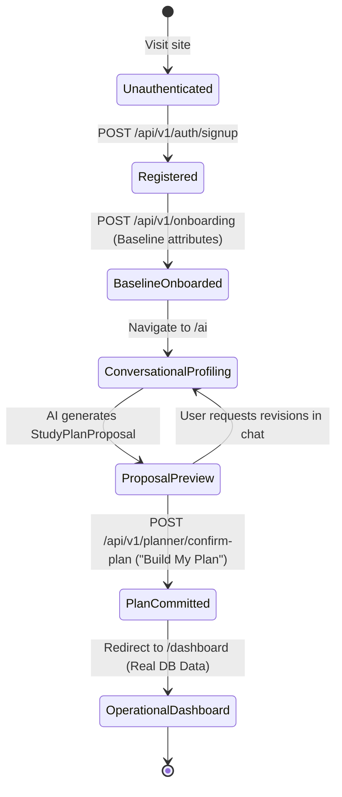

# Data Model & Schema Specification: Authentication → Student Onboarding → AI-First Learning Setup

## 1. Relational Entities & Attributes

### 1.1 User (`users`)
Represents the authenticated student identity.

| Attribute | Type | Constraints | Description |
| --- | --- | --- | --- |
| `id` | UUID (string) | Primary Key | Unique user identifier |
| `email` | String(255) | Unique, Not Null, Indexed | Account email address |
| `hashed_password` | String(255) | Not Null | Bcrypt/Argon2 password hash |
| `full_name` | String(100) | Not Null | Student's display name |
| `is_active` | Boolean | Default: True | Account status flag |
| `is_onboarded` | Boolean | Default: False | Flag indicating plan approval completion |
| `created_at` | DateTime (UTC) | Not Null | Registration timestamp |
| `updated_at` | DateTime (UTC) | Not Null | Last update timestamp |

### 1.2 StudentProfile (`student_profiles`)
Represents baseline education attributes and conversationally extracted academic facts.

| Attribute | Type | Constraints | Description |
| --- | --- | --- | --- |
| `id` | UUID (string) | Primary Key | Profile record ID |
| `user_id` | UUID (string) | FK -> users.id, Unique, Not Null | Owner reference |
| `education_level` | String(50) | Not Null | e.g. "High School", "Undergraduate" |
| `board_curriculum` | String(50) | Not Null | e.g. "CBSE", "ICSE", "State Board", "SAT" |
| `grade_class` | String(50) | Not Null | e.g. "Class 12", "Grade 11" |
| `target_subjects` | JSONB / Array | Not Null | Enrolled subject list e.g. ["Calculus", "Physics"] |
| `weak_topics` | JSONB / Array | Default: [] | Extracted topics requiring priority review |
| `strong_topics` | JSONB / Array | Default: [] | Extracted topics with high mastery |
| `completed_topics` | JSONB / Array | Default: [] | Extracted topics already finished |
| `daily_time_minutes` | Integer | Default: 180, > 0 | Daily available study time budget |
| `exam_date` | Date | Nullable | Target exam date |
| `score_goal` | Integer | Default: 85, 1-100 | Target score percentage |
| `study_routine` | String(500) | Nullable | Student's routine/constraints description |
| `created_at` | DateTime (UTC) | Not Null | Creation timestamp |
| `updated_at` | DateTime (UTC) | Not Null | Last update timestamp |

### 1.3 Subject & Topic (`subjects`, `topics`)
Catalog of academic subjects and fine-grained topics.

| Entity | Attribute | Type | Constraints | Description |
| --- | --- | --- | --- | --- |
| **Subject** | `id` | String(50) | PK | Unique slug e.g. "calculus" |
| | `name` | String(100) | Not Null | Display name e.g. "Calculus" |
| **Topic** | `id` | String(100) | PK | Unique slug e.g. "topic-integration-parts" |
| | `subject_id` | String(50) | FK -> subjects.id | Parent subject slug |
| | `name` | String(255) | Not Null | Topic title |
| | `difficulty` | Integer | Default: 3, 1-5 | Standard difficulty rating |

### 1.4 AI Conversation & Messages (`ai_conversations`, `ai_messages`)
Stores natural language profiling dialogue and AI reasoning outputs.

| Entity | Attribute | Type | Constraints | Description |
| --- | --- | --- | --- | --- |
| **AIConversation** | `id` | UUID (string) | PK | Conversation session ID |
| | `user_id` | UUID (string) | FK -> users.id, Not Null | Owner reference |
| | `created_at` | DateTime (UTC) | Not Null | Session start time |
| | `last_active_at` | DateTime (UTC) | Not Null | Last message timestamp |
| **AIMessage** | `id` | UUID (string) | PK | Message ID |
| | `conversation_id` | UUID (string) | FK -> ai_conversations.id, Not Null | Parent conversation |
| | `role` | String(20) | Not Null | "system", "user", or "assistant" |
| | `content` | Text | Not Null | Message body |
| | `provider_used` | String(50) | Nullable | "omniroute" or "opencode_zen" |
| | `model_used` | String(100) | Nullable | Configured model ID used |
| | `created_at` | DateTime (UTC) | Not Null | Message timestamp |

### 1.5 Study Plan & Versions (`study_plans`, `study_plan_versions`)
Master study plan metadata and versioned commitments.

| Entity | Attribute | Type | Constraints | Description |
| --- | --- | --- | --- | --- |
| **StudyPlan** | `id` | UUID (string) | PK | Master plan ID |
| | `user_id` | UUID (string) | FK -> users.id, Unique, Not Null | Owner reference |
| | `active_version_id` | UUID (string) | Nullable | Currently active version ID |
| | `created_at` | DateTime (UTC) | Not Null | Plan creation timestamp |
| **StudyPlanVersion** | `id` | UUID (string) | PK | Version ID |
| | `plan_id` | UUID (string) | FK -> study_plans.id, Not Null | Parent plan |
| | `version_number` | Integer | Not Null | Incremental version e.g. 1, 2 |
| | `source` | String(50) | Not Null | "AI_PROPOSAL_INITIAL" or "AI_REVISION" |
| | `summary` | Text | Nullable | AI plan summary explanation |
| | `created_at` | DateTime (UTC) | Not Null | Version commit timestamp |

### 1.6 StudyTask (`study_tasks`)
Individual scheduled operational tasks bound to a plan version.

| Attribute | Type | Constraints | Description |
| --- | --- | --- | --- |
| `id` | UUID (string) | PK | Task ID |
| `plan_version_id` | UUID (string) | FK -> study_plan_versions.id, Not Null | Version reference |
| `user_id` | UUID (string) | FK -> users.id, Not Null, Indexed | Owner reference for direct querying |
| `topic_id` | String(100) | FK -> topics.id, Not Null | Target topic reference |
| `scheduled_date` | Date | Not Null, Indexed | Date task is scheduled for |
| `scheduled_time` | String(10) | Not Null | Format "HH:MM" e.g. "09:00" |
| `duration_minutes` | Integer | Not Null, > 0 | Planned duration in minutes |
| `completed` | Boolean | Default: False | Completion status |
| `priority_tag` | String(50) | Not Null | "High", "Weak Area", "Spaced Revision", "Regular" |
| `created_at` | DateTime (UTC) | Not Null | Record timestamp |

### 1.7 ProgressLog, Streak & Readiness (`progress_logs`, `streaks`, `readiness_scores`)
Operational study history and calculated metrics.

| Entity | Attribute | Type | Constraints | Description |
| --- | --- | --- | --- | --- |
| **ProgressLog** | `id` | UUID (string) | PK | Log entry ID |
| | `user_id` | UUID (string) | FK -> users.id, Not Null | Owner reference |
| | `task_id` | UUID (string) | Nullable | Linked task ID |
| | `topic_id` | String(100) | FK -> topics.id, Not Null | Studied topic |
| | `confidence_rating` | Integer | 1-5, Not Null | Active recall score |
| | `duration_minutes` | Integer | > 0, Not Null | Actual minutes studied |
| | `completed_at` | DateTime (UTC) | Not Null | Session completion timestamp |
| **Streak** | `user_id` | UUID (string) | PK, FK -> users.id | Owner reference |
| | `current_streak` | Integer | Default: 0 | Active consecutive days |
| | `longest_streak` | Integer | Default: 0 | Best consecutive days |
| | `last_study_date` | Date | Nullable | Last logged date |
| **ReadinessScore** | `user_id` | UUID (string) | PK, FK -> users.id | Owner reference |
| | `probability` | Integer | Default: 0, 0-100 | Predicted exam readiness |
| | `avg_confidence` | Float | Default: 0.0 | Calculated mean rating |
| | `completion_rate` | Float | Default: 0.0 | Calculated plan completion % |
| | `last_updated` | DateTime (UTC) | Not Null | Calculation timestamp |

---

## 2. State Transitions

### User Registration & Onboarding Lifecycle

